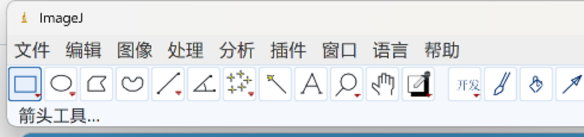

# ImageJ-Prosth-CN — ImageJ 非官方中文汉化版

> 面向口腔 / 正畸场景的 **ImageJ 1.54u** 中文汉化发行版。
>
> **⚠️ 本项目是 ImageJ 的非官方衍生版，非 NIH / ImageJ 官方发布。**



---

## 一、这个项目是什么

图像处理内核**完全来自 ImageJ 1.54u**，本项目只做两件事：

### 1. 汉化
- 界面文案全量中文化：菜单栏、工具栏工具名与状态栏提示、通用对话框、结果窗口、错误提示
- 语言包约 **1459 条词条**，覆盖 ImageJ 主要交互路径
- 顶级「语言」菜单支持 **中文 / English 一键切换**，无需重启，偏好持久保存
- 按**口腔与正畸语境**调整术语（如工具说明、测量相关文案），而非机翻

### 2. 界面美化
- 统一设计令牌（`ij.ui.Theme`）：强调色、面板色、边框色、文字色集中管理
- 工具栏按钮改为**圆角 + 悬浮高亮**，选中态与普通态分色
- 对话框主 / 次按钮改用自绘强调按钮（主按钮实心、次按钮描边）
- 状态栏加分隔线与内边距，文字不再贴边溢出

### 3. 高分辨率适配
- **4K / 高分屏自动 GUI 缩放**：按物理 DPI 与分辨率推算，取 0.25 整数倍，钳制 1.0–3.0
- **防双重放大**：先检测 JVM 是否已按系统 DPI 缩放（JEP 263），已缩放则不再重复放大
- 支持 **Windows 系统缩放 100% – 200%**（125% / 150% / 175% / 200%）
- 23 个 UI 组件跟随缩放（工具栏、状态栏、对话框、按钮、ROI 手柄、各面板窗口）

> 说明：适配按**主显示器**计算。多显示器且 DPI 不一致时不会随窗口跨屏重算。

---

## 二、下载

前往 [Releases](../../releases) 页面：

| 包 | 说明 |
|---|---|
| `ImageJ-Prosth-CN-win64.zip` | **便携包**：内置 OpenJDK 17，解压即用，无需安装 Java |

> 纯绿色版，不写注册表、不建系统服务。如需 MSI，可在构建机安装 WiX 后自行 `jpackage --type msi`，见「构建」章节。

---

## 三、使用

1. 解压便携包（或运行安装包）
2. 双击 `ImageJ-Prosth-CN.exe`
3. 打开图像后即可使用；菜单「语言」可在中文 / English 间切换

详细操作见仓库内 `使用说明.txt`。

---

## 四、构建

需要 JDK 17+：

```bash
cd src/ImageJ-master
javac -encoding UTF-8 -cp . -d build ij/ImageJ.java   # 或使用 build.xml
jar cf ij-zh.jar -C build .
```

打包为带运行时的发行版（jpackage）：

```bash
jpackage --type app-image --name ImageJ-Prosth-CN \
         --input app --main-jar ij-zh.jar --main-class ij.ImageJ \
         --java-options -Xmx4g
```

生成 msi 安装包需额外安装 [WiX Toolset](https://wixtoolset.org/)。

---

## 五、文件结构

- `src/ImageJ-master/` — Upstream ImageJ 1.54u source tree with localization and UI changes applied.
- `src/ImageJ-master/ij/i18n/` — Localization layer: dictionary loader, translate/restore routines, UI font resolution.
- `src/ImageJ-master/ij/ui/Theme.java` — Central design tokens (accent, surface, panel, border, text colors, corner radius).
- `src/ImageJ-master/ij/gui/AccentButton.java` — Custom-drawn rounded button used for primary and secondary dialog actions.
- `src/ImageJ-master/ij/Prefs.java` — Preference storage; hosts `autoGuiScale()` for HiDPI auto-adaptation.
- `src/ImageJ-master/macros/` — Startup tool macros, including the 「开发」 toolbar tool definition.
- `docs/screenshots/` — Interface screenshots used by this README.
- `使用说明.txt` — End-user operating manual (Chinese).
- `汉化检查报告.txt` — Localization coverage report: scope, methods, and entry counts.
- `LICENSE` — Public domain notice for ImageJ plus third-party license summary.
- `NOTICE` — Third-party component notice, including the bundled OpenJDK runtime.

---

## 六、许可证

| 部分 | 许可证 |
|---|---|
| ImageJ 1.54u 内核 | **Public Domain**（NIH 职务作品，17 U.S.C. §105） |
| 本项目汉化与界面改动 | **Public Domain / CC0-1.0** |
| 内置 OpenJDK 17 运行时 | **GPLv2 + Classpath Exception**（文本见 `runtime/legal/`） |

Classpath Exception 确保本项目的 Java 代码不被 GPL 传染，可自由使用与再分发。

详见 [LICENSE](LICENSE) 与 [NOTICE](NOTICE)。

---

## 七、致谢与免责

- 感谢 **Wayne Rasband** 与 **NIH** 将 ImageJ 释出到公有领域
- 感谢 ImageJ 社区
- **汉化：基耶杰**

> 本项目仅供**研究与教学**使用，不用于临床诊断。
> 涉及医学影像的判读请以持证医师意见为准。
